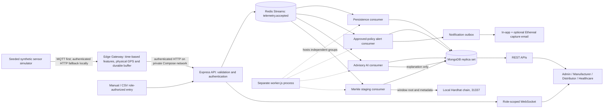

# Vaccine supply-chain software prototype

**Scope note:** [ARCHITECTURE.md](ARCHITECTURE.md) describes the implementation verified in this repository; [FUTURE_ARCHITECTURE.md](FUTURE_ARCHITECTURE.md) preserves the earlier target design and is explicitly not a description of the running system.

Existing React + Express/Mongoose + FastAPI + Solidity architecture, extended with a software sensor simulator, authenticated Edge Gateway, MQTT/HTTPS ingestion, Redis Streams consumers, policy-authoritative alerts, advisory AI analytics, Merkle sensor anchoring on local Hardhat, and role-scoped real-time dashboards. **Software-only, synthetic demo/test use. Not a clinical system or production-certified deployment.**

## Current architecture



The approved batch policy alone determines safety alerts and holds; AI output is advisory. Sensor records, routes, demand, inventory and email recipients are synthetic/demo fixtures. The local chain is ephemeral Hardhat, not a public network. See [current state](docs/CURRENT_STATE.md), [Phase 7 acceptance/evaluation](docs/PHASE7_ACCEPTANCE_EVALUATION.md), and [future-state design](FUTURE_ARCHITECTURE.md).

## Current evidence

See [current state](docs/CURRENT_STATE.md) and [final-fix evidence](docs/PHASE11_FREEZE.md). The normal-only advisory temperature model uses elapsed-time features and a held-out normal cutoff, with raw and 2-of-3 persisted outputs. GPS uses a separate haversine speed rule (`MAX_SPEED_KMH=120`), not a learned feature. Humidity has an explanatory baseline metric. Policy rules alone control alerts/holds. Regional forecasts compare SARIMA with seasonal naive; supply recommendations require authorized human approval and never auto-dispatch. Maps plot synthetic saved fixes, not real vehicles. Compose enables disposable Ethereal capture, not production email. Historical commands/results are labelled as such in the documentation.

## One-command local demo

Prerequisites: Docker Desktop with its engine running, Node.js 20+, and outbound internet access for first-time image pulls and disposable Ethereal email capture. From the repository root run:

```powershell
node .\scripts\run-demo.js
```

The launcher creates a private, ignored `.env` with random local-only secrets if one does not exist, builds and waits for the Compose services, then seeds synthetic demo accounts/data. It never overwrites an existing `.env`. Dashboards: `http://localhost:3000`; field operator panel: `http://localhost:5173`. Seeded roles share the `DEMO_SEED_PASSWORD` value in `.env`. To prove the alert-to-chain path, run `node .\scripts\acceptance.js`; to create the evaluation report, run `node .\scripts\evaluate.js`.

For transferring this project to another Windows computer, see the [portable setup and presentation guide](docs/PORTABLE_SETUP_AND_PRESENTATION.md). It covers ZIP contents, software installation, first-run commands, demo logins, all five role features, presentation flow, and troubleshooting.

To stop services without deleting their data, use `docker compose down`. Do not use `docker compose down -v` on a working demo: the local Hardhat node is in-memory and restarting it loses chain history.

## Viva demo, step by step

1. Run `node .\scripts\run-demo.js`; wait for the stack and synthetic seed to complete.
2. Open `http://localhost:3000` in four separate tabs. Sign in as `admin@demo.synthetic.test`, `manufacturer@demo.synthetic.test`, `distributor@demo.synthetic.test`, and `healthcare@demo.synthetic.test`, choosing the matching role. All use the private root `.env` value `DEMO_SEED_PASSWORD`; do not display it in a presentation.
   The field panel also has `fieldoperator@demo.synthetic.test` with that same demo password; use the field panel's own sign-in flow for that role.
3. In Admin, show dependency readiness, seeded batches/policies, inventory, forecasts with synthetic provenance and approval-only supply planning. Keep the authoritative 2–8 C batch policy visible.
4. Use the simulator controls to create/select a batch-linked device and shipment, run `normal`, then `door_open`. Show the chart, saved route, policy reason, notifications and the separately labelled AI advisory. Alternatively enter a manual 11 C reading with a note; it uses the same Redis/policy/anchoring path and retains its Manual badge.
5. Open the alert in the authorized role tabs; show actor/source, location, vehicle, timestamps, notified roles and anchoring status. Show the captured Ethereal preview only as a test email.
6. Wait for the demo Merkle window (default Compose 30 seconds), then open the batch QR verification URL in the signed-in Healthcare tab. Show batch identity separately from anchored/pending sensor evidence.
7. Run `node .\scripts\acceptance.js` to prove the simulated/manual path and API-restart isolation. Run `node .\scripts\evaluate.js` for the platform experiment. The final detector comparison is in `results/ai_vs_threshold.md` and `.json`, with per-scenario metrics and all high-FAR conditions.
8. Demonstrate append-only correction through the authorized UI/API, not by editing Mongo records. The dedicated synthetic tamper proof in `backend/scripts/liveMerkleChainProof.js` intentionally changes only its own fixture and restores it; never use that pattern for real records.

## Frozen-demo limitations

- Synthetic injections, noise, demand, GPS and inventory are not independently measured field or clinical data. Policy thresholds are approved demo configuration, not clinical advice.
- Statistical calibration is original-setting normal-only; robustness evaluation never retunes. See the measured >10% false-alarm conditions in the final results. Noise ×2 can itself take an injection-labelled normal reading outside policy, so comparator FAR is against injection labels, not evidence that the policy engine is wrong.
- The final 30-run experiment completed all 17 robustness conditions. Persisted AI normal FAR was 0% at 10-second sampling on those seeds but 44.68% under noise ×2. The statistical edge comparator missed baseline door-open; deployed local/approved policy checks still detected it. All 35 high-FAR method/condition pairs are reported, not removed.
- Deployed edge local temperature checks are immediate threshold advisories. The calibrated statistical edge comparator/hysteresis is evaluation-only; both share time math and physical GPS checking. AI persistence does not delay a physical GPS flag.
- The AI benchmark overrides the embedded default cutoff with one calibrated on ten separate original-setting simulator-normal runs. Both calibrations are normal-only and disjoint from evaluation seeds; benchmark performance is not an exact measurement of the deployed default operating point.
- Seeded batches are not manufacturing-released: the live plan proof returned zero allocation and preserved stock. Use the authorized production/lab/report/release workflow before expecting eligible stock. Seeded order history is exactly seasonally repeating; near-zero forecast errors and collapsed intervals are not real-world demand validation.
- Hardhat is an in-memory local development chain. Restarting it invalidates previous evidence even when Mongo survives. Compose volume deletion also removes stored demo data/artifacts.
- MQTT and HTTP operate on the private local Compose network; HTTPS/TLS is required/configured separately for remote deployment. This is not a hardened public deployment.
- Browser visual/Safari QA, physical hardware, public-chain verification and real-recipient email delivery are not verified in this freeze. Dependency audit advisories remain; do not deploy this as a production system.

## Manual local setup

1. Start local MongoDB. Review `backend/.env.example`; keep random JWT/refresh/temperature API secrets in ignored `backend/.env`. Existing demo passwords were hashed without changing their values; log in again because old sessions were invalidated. Do not use these accounts on a public service.
2. In `blockchain`, run `npm test`, then `npm run node` (loopback only). In a second terminal run `npm run deploy:local`. This updated contract is not compatible with an older deployment; configure the new address in backend `.env`. Explicitly set `LOCAL_CHAIN_DEMO=true` for public Hardhat **test** accounts. `AUDIT_ANCHOR_ENABLED=true` queues raw sensor records plus a digest per reading, and digest anchors for cold-chain audit events. Never fund these keys. See [chain guide](docs/LOCAL_BLOCKCHAIN.md).
3. In `ai-services`, run `python -m uvicorn main:app --host 127.0.0.1 --port 8000`. Default forecasting needs no model download or training. Sentiment is a labeled heuristic unless explicitly opting into the experimental BERT model.
4. In `backend`, run `npm start` (or `node server.js`). In `frontend`, run `npm start` (or `node node_modules/react-scripts/bin/react-scripts.js start`). The backend binds to loopback by default.
5. Admin/Manufacturer dashboards expose simulator creation and lifecycle, policy approval, alert/quality-review controls and opt-in silence monitoring. Admin also has the constrained supply-planning preview. See [simulator](docs/IOT_SIMULATOR.md), [quality review](docs/TEMPERATURE_ALERTS.md), and [planning](docs/SUPPLY_PLANNING.md).

Older batches with unknown expiry or unreleased placeholders are intentionally excluded from planning. Do not invent missing operational facts. New batch creation APIs accept `expiresAt`; generator temperature bounds are simulation settings, not an approved medical policy.

For the authenticated local Compose stack, repeatable all-role synthetic seed, bounded telemetry ingestion, Ethereal capture email, and Admin service readiness panel, see [Reliable local platform setup](docs/RELIABLE_PLATFORM.md). Docker availability and outbound Ethereal SMTP access are required for the full green readiness acceptance.

Manufacturer **Create New Batch** now opens a user-input form that runs the existing manufacturing workflow and refreshes the dashboard. See the [step-by-step batch creation guide](docs/MANUFACTURER_BATCH_CREATION.md), including validation, separate release sign-offs and safe failure recovery.

Manufacturer batch rows can show a protected verification QR containing the latest local-chain sensor record ID and digest when available. The signed-in Healthcare dashboard checks the proof against the configured contract; manual batch-ID entry checks batch identity only. See the [traceability and demo guide](docs/TRACEABILITY_AND_DEMO_FEATURES.md#batch-qr-verification) and [healthcare workflow steps](docs/OPERATIONAL_DASHBOARD_GUIDE.md#user-input-flow).

See the [website control/layout audit](docs/UI_FUNCTIONAL_AUDIT.md) for the role-by-role control inventory, repaired workflows, verification coverage and explicit prototype limits.

## Verify

- `backend`: `npm test`, `npm run audit:integrity`, `node scripts/runSystemAcceptance.js --execute`, `node scripts/evaluatePrototype.js`.
- `frontend`: `npm test -- --watchAll=false --runInBand`, `npm run build`.
- `blockchain`: `npm test`.
- `ai-services`: `python -m unittest discover -s tests -v`, `python evaluate_forecast.py`.
- Repository scripts: `node scripts/acceptance.js`, `node scripts/evaluate.js`.

The Phase 7 acceptance/evaluation flows add uniquely named, explicitly synthetic records to the current Compose demo so their on-chain evidence remains verifiable; they do not delete or reseed existing application records. CI runs against a fresh ephemeral Compose project. No physical hardware, public chain, or clinical data is used. [Security boundaries](docs/SECURITY_HARDENING.md) and remaining research/production gates are documented explicitly.
